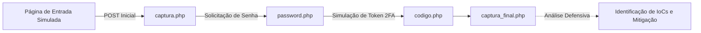

<p align="center">
  
</p>

<h1 align="center">Cybersecurity-phishing-defense</h1>

<p align="center">Laboratório acadêmico sobre engenharia social, análise de phishing e práticas de defesa.</p>

<p align="center">
  
  
  
</p>

<p align="center"><a href="#visão-geral">Visão geral</a> &nbsp;·&nbsp; <a href="#recursos">Recursos</a></p>

---

## Visão geral

A análise do código permite observar os indicadores clássicos que mecanismos de defesa e analistas de segurança procuram: domínios discrepantes, formulários que desviam o fluxo de autenticação para scripts intermediários (captura.php, password.php, codigo.php) e persistência indevida de entradas em banco de dados.

## Recursos

| Aspecto estudado | Análise técnica e defensiva |
|---|---|
| Engenharia social em múltiplas etapas | Demonstra como páginas falsas dividem a coleta em e-mail, senha e código de verificação para parecerem legítimas. |
| Inspeção de endpoints de formulário | Evidencia como o atributo action aponta para scripts PHP locais em vez de provedores OAuth oficiais. |
| Persistência em laboratório | O arquivo db_config.php ilustra como atacantes armazenam dados capturados em ambientes improvisados. |
| Indicadores de comprometimento (IoCs) | Serve como base para treinar a verificação de certificados TLS, URLs, cabeçalhos HTTP e gerenciadores de senhas. |

## Tecnologias

- **HTML5 e CSS3** na reprodução visual de tela de acesso para análise de fidelidade visual;
- **PHP** na demonstração do encadeamento de requisições POST entre etapas;
- **MySQL (db_config.php)** para estudo da camada de armazenamento do laboratório.

<details>
<summary>Arquitetura do estudo</summary>



Ao mapear cada etapa do funil, fica evidente por que a autenticação multifator resistente a phishing (como FIDO2 / WebAuthn e Passkeys) e a validação de origem pelo gerenciador de senhas bloqueiam esse vetor de ataque.

</details>

<details>
<summary>Estrutura do repositório</summary>

```text
Cybersecurity-phishing-defense/
├── assets/
│   └── project-animal.png          Emblema do projeto
├── spotify/
│   ├── index.html                  Interface inicial de estudo
│   ├── captura.php                 Primeira etapa do fluxo simulado
│   ├── password.php                Segunda etapa do fluxo simulado
│   ├── codigo.php                  Terceira etapa (simulação de código)
│   ├── captura_final.php           Encerramento do fluxo de laboratório
│   └── db_config.php               Configuração de banco para ambiente de teste
└── README.md
```

</details>

## Como explorar com segurança

1. Clone o repositório apenas em uma máquina virtual ou ambiente local isolado (localhost):
   ```bash
   git clone https://github.com/arthurlynow098/Cybersecurity-phishing-defense.git
   ```
2. Inspecione os arquivos .html e .php em um editor de código para analisar os vetores de redirecionamento e captura.
3. Caso execute em servidor local para demonstração acadêmica, utilize **exclusivamente dados fictícios**.

## Decisões técnicas e lições de defesa

- **Por que o gerenciador de senhas protege:** gerenciadores verificam o domínio real da página antes de preencher credenciais, neutralizando clones visuais hospedados em outros endereços.
- **Limitações de 2FA por código digitado:** o fluxo codigo.php demonstra como ataques *Reverse Proxy / AiTM* ou coleta em tempo real tentam capturar códigos OTP manuais, reforçando a importância de chaves de segurança vinculadas ao domínio.

---

<p align="center">
  <a href="https://github.com/arthurlynow098">GitHub</a> &nbsp;·&nbsp;
  <a href="https://arthurentsev.vercel.app/">Portfólio</a> &nbsp;·&nbsp;
  <a href="https://www.linkedin.com/in/entsevarthur/">LinkedIn</a>
</p>
