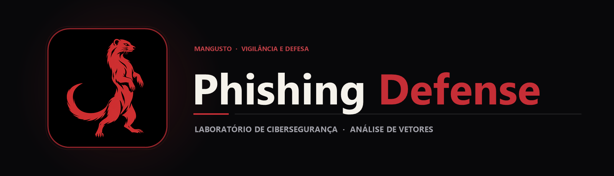

  

  Laboratório acadêmico de cibersegurança para estudo prático de vetores de engenharia social, anatomia de páginas falsas e estratégias de defesa contra Phishing.

  
  
  

> [!IMPORTANT]
> **Aviso de uso ético e educacional:** Este repositório foi desenvolvido exclusivamente como atividade curricular na **Fatec** para demonstrar em ambiente controlado como ataques de engenharia social operam nos bastidores e como identificá-los. Utilize apenas em laboratório isolado e com dados fictícios.

## Sobre o projeto

Compreender na prática como um ataque de *Phishing* é estruturado é uma das formas mais eficazes de treinar equipes e usuários a reconhecerem sinais de fraude digital. Este projeto acadêmico disseca o fluxo técnico de uma campanha simulada de captura de credenciais em múltiplas etapas.

A análise do código permite observar os indicadores clássicos que mecanismos de defesa e analistas de segurança procuram: domínios discrepantes, formulários que desviam o fluxo de autenticação para scripts intermediários (captura.php, password.php, codigo.php) e persistência indevida de entradas em banco de dados.

## Principais recursos

| Aspecto estudado | Análise técnica e defensiva |
|---|---|
| Engenharia social em múltiplas etapas | Demonstra como páginas falsas dividem a coleta em e-mail, senha e código de verificação para parecerem legítimas. |
| Inspeção de endpoints de formulário | Evidencia como o atributo ction aponta para scripts PHP locais em vez de provedores OAuth oficiais. |
| Persistência em laboratório | O arquivo db_config.php ilustra como atacantes armazenam dados capturados em ambientes improvisados. |
| Indicadores de comprometimento (IoCs) | Serve como base para treinar a verificação de certificados TLS, URLs, cabeçalhos HTTP e gerenciadores de senhas. |

## Tecnologias

  
  
  
  

- **HTML5 e CSS3** na reprodução visual de tela de acesso para análise de fidelidade visual;
- **PHP** na demonstração do encadeamento de requisições POST entre etapas;
- **MySQL (db_config.php)** para estudo da camada de armazenamento do laboratório.

## Arquitetura do estudo

`mermaid
flowchart LR
    A[Página de Entrada Simulada] -->|POST Inicial| B[captura.php]
    B -->|Solicitação de Senha| C[password.php]
    C -->|Simulação de Token 2FA| D[codigo.php]
    D --> E[captura_final.php]
    E -.->|Análise Defensiva| F[Identificação de IoCs e Mitigação]
`

Ao mapear cada etapa do funil, fica evidente por que a autenticação multifator resistente a phishing (como FIDO2 / WebAuthn e Passkeys) e a validação de origem pelo gerenciador de senhas bloqueiam esse vetor de ataque.

## Estrutura do repositório

`	ext
Cybersecurity-phishing-defense/
├── assets/
│   ├── banner.png                  Banner principal do laboratório
│   └── project-animal.png          Símbolo do mangusto (defesa ágil)
├── spotify/
│   ├── index.html                  Interface inicial de estudo
│   ├── captura.php                 Primeira etapa do fluxo simulado
│   ├── password.php                Segunda etapa do fluxo simulado
│   ├── codigo.php                  Terceira etapa (simulação de código)
│   ├── captura_final.php           Encerramento do fluxo de laboratório
│   └── db_config.php               Configuração de banco para ambiente de teste
└── README.md
`

## Como explorar com segurança

1. Clone o repositório apenas em uma máquina virtual ou ambiente local isolado (localhost):
   `ash
   git clone https://github.com/arthurlynow098/Cybersecurity-phishing-defense.git
   `
2. Inspecione os arquivos .html e .php em um editor de código para analisar os vetores de redirecionamento e captura.
3. Caso execute em servidor local para demonstração acadêmica, utilize **exclusivamente dados fictícios**.

## Decisões técnicas e lições de defesa

- **Por que o gerenciador de senhas protege:** gerenciadores verificam o domínio real da página antes de preencher credenciais, neutralizando clones visuais hospedados em outros endereços.
- **Limitações de 2FA por código digitado:** o fluxo codigo.php demonstra como ataques *Reverse Proxy / AiTM* ou coleta em tempo real tentam capturar códigos OTP manuais, reforçando a importância de chaves de segurança vinculadas ao domínio.

---

Estudo · construção · evolução <a href="https://github.com/arthurlynow098">Perfil</a> · <a href="https://arthurentsev.vercel.app/">Portfólio</a> · <a href="https://www.linkedin.com/in/entsevarthur/">LinkedIn</a>

